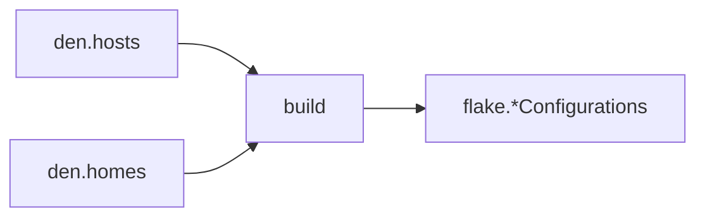

import { Aside, Steps } from '@astrojs/starlight/components';

<Aside title="Source" icon="github">
[`modules/outputs/*.nix`](https://github.com/denful/den/blob/main/modules/outputs) --
[`modules/outputs.nix`](https://github.com/denful/den/blob/main/modules/outputs.nix) --
[`per system tests`](https://github.com/denful/den/blob/main/templates/ci/modules/public/c2-policies-outputs/packages-merge.nix)
</Aside>

## Build pipeline

Den converts `den.hosts` and `den.homes` declarations into flake outputs
through a unified pipeline:



### Host instantiation

For each host in `den.hosts`, Den builds the configuration from that host's
part of the fleet-wide resolve, and falls back to `host.mainModule` when that
part is empty. Building a host from its `mainModule` yourself looks like this:

```nix
host.instantiate {
  modules = [
    host.mainModule
    { nixpkgs.hostPlatform = lib.mkDefault host.system; }
  ];
}
```

What a `mainModule` build carries depends on whether an entity kind sits above
hosts:

- **No entity kind above hosts** (the default): `mainModule` is the host's own
  resolve, computed from the host alone. It has the host-class content of the
  configuration den puts in `flake.<intoAttr>`, including what the host
  delivers to its users and receives back through them (`provides.to-users`,
  `provides.<user>`), but not values its pipes collect from other hosts.
- **An entity kind above hosts** (`den.schema.host.parent`, such as an
  `environment`): `mainModule` is the host's part of the fleet-wide resolve,
  the same modules its configuration is built from, so it carries what that
  kind delivers too. Reading its modules pays for the whole fleet walk the
  first time, as building any host's configuration already does, and an error
  in another host's include reaches it, as it reaches every configuration den
  builds. A host delivered from two scopes is refused by name, where its
  configuration warns and keeps the last. A host the flake doesn't
  instantiate keeps its own resolve.

Under an entity kind above hosts, a host's `mainModule` is a late value: an
include or policy can bind it, or ask `mainModule ? imports`, but reading the
modules inside it while den is still resolving the fleet is a cycle. Read them
from a class module, a flake output or the repl, after the walk.

The result is placed at `flake.<intoAttr>` -- by default
`flake.nixosConfigurations.<name>` or `flake.darwinConfigurations.<name>`.

### Home instantiation

For each home in `den.homes`, Den calls:

```nix
home.instantiate {
  pkgs = home.pkgs;
  modules = [ home.mainModule ];
}
```

The result lands at `flake.homeConfigurations.<name>` by default.

## `outputs.nix` -- flake-parts compatibility

When `inputs.flake-parts` is absent, Den defines its own `options.flake`
option so that output generation works identically with or without flake-parts.

This means Den can produce `nixosConfigurations`, `darwinConfigurations`,
`homeConfigurations`, and any custom output attribute regardless of
whether flake-parts is loaded.

## Custom output paths

Override `intoAttr` on any host or home to place outputs at a custom path:

```nix
den.hosts.x86_64-linux.myhost = {
  intoAttr = [ "nixosConfigurations" "custom-name" ];
};
```

Use `intoAttr = [ ]` to skip placing the configuration.

## Custom instantiation

Override `instantiate` to use a different builder or add `specialArgs`:

```nix
den.hosts.x86_64-linux.myhost = {
  instantiate = inputs.nixos-unstable.lib.nixosSystem;
};
```

## `den.systems`

The list of systems the flake walks. Drives the `flake-to-systems` policy --
one `flake-system` scope per entry, which fans out to that system's hosts
and homes.

**Type:** `listOf str` · **Default:** the union of the system keys of
`den.hosts` and `den.homes`; if you declare neither, `lib.systems.flakeExposed`.

```nix
# Explicit -- e.g. to pin the system set or add a system with no hosts yet:
den.systems = [ "x86_64-linux" ];
```

## Flake outputs like `packages`, `checks`, etc.

Den aspects can directly contribute to `packages` and similar flake outputs.

The following example are for `packages` but same applies for `checks`, `devShells`,
`legacyPackages` and other per system outputs.

<Steps>

1. Define `flake.packages` output.

     This is only needed if you don't use flake-parts and will have more than one package,
     because the Nix module system needs to know how to merge both output definitions:

     ```nix
     # modules/outputs.nix
     { inputs, ... }:
     {
       imports = [ inputs.den.flakeOutputs.packages ];
     }
     ```

2. Allow aspects to produce `packages`.

     ```nix
     # ANY Host or User aspect can produce outputs:
     # The system-to-os-outputs policy handles per-host fan-out.
     # To include aspects in flake outputs:
     den.schema.flake-system.includes = [ den.aspects.foo ];
     ```

     For a walkthrough of every output class and where each is collected from,
     see [Flake Outputs from Aspects](/guides/flake-outputs/).

3. Use the `packages` class on your aspects:

     ```nix
     den.aspects.foo = {
        packages = { pkgs, ... }: { inherit (pkgs) hello; };
     };
     ```

</Steps>

See [`packages-merge.nix`](https://github.com/denful/den/blob/main/templates/ci/modules/public/c2-policies-outputs/packages-merge.nix) for worked examples.
